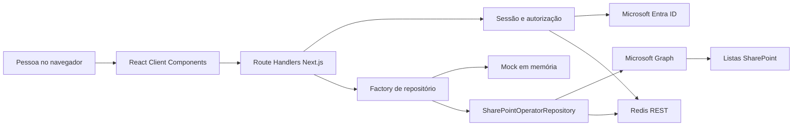
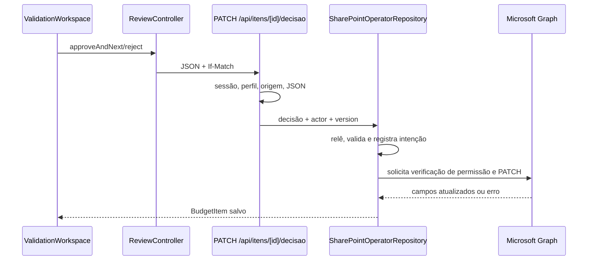

# Arquitetura do `operator-web`

O `operator-web` é o módulo web de operação do Sistema 3P, não o sistema inteiro. Ele reúne interface React e um BFF (*Backend for Frontend*) Next.js; identidade, Microsoft Graph, SharePoint, Redis e hospedagem são dependências externas.

## React, App Router e renderização

`src/app/layout.tsx` define o layout; `src/app/page.tsx` atende `/`; `src/app/login/page.tsx`, `/login`; e `src/app/orcamentos/[budgetId]/page.tsx`, qualquer orçamento. Páginas são **Server Components** por padrão e podem validar sessão no servidor. `BudgetQueue` e `ValidationWorkspace` usam `"use client"`, `useState`, `useEffect` e eventos, portanto executam no navegador.

Em analogia com Java, um Server Component se aproxima de um controller que prepara a resposta; um Client Component é um objeto de interface que mantém estado durante a interação.

## Camadas

| Camada | Arquivos | Responsabilidade |
| --- | --- | --- |
| Interface | `src/components/*` | Renderizar fila, itens, materiais e ações. |
| Domínio | `src/domain/*` | Seleção, navegação, decisão e preservação de estado. |
| Contrato | `src/repositories/operator-repository.ts` | Definir operações sem conhecer a persistência. |
| Cliente BFF | `src/repositories/bff/*` | Converter operações em `fetch` para `/api/*`. |
| BFF | `src/app/api/**/route.ts` | Autenticar, limitar, validar e responder HTTP. |
| Servidor | `src/server/*` | Auth, segurança, configuração, Graph e SharePoint. |
| Modelos | `src/types/operator.ts` | Tipos de orçamento, item, material e decisão. |

`OperatorRepository` equivale a uma interface Java. `MockOperatorRepository` e `SharePointOperatorRepository` são implementações; `createServerOperatorRepository()` escolhe uma conforme `DATA_SOURCE`. Não há fallback silencioso de SharePoint para mock.

## Endpoints reais

| Método/URL | Uso |
| --- | --- |
| `GET /api/orcamentos` | Fila e progresso. |
| `GET /api/orcamentos/[id]/itens` | Itens ordenados. |
| `GET /api/materiais?q=...` | Catálogo oficial. |
| `PATCH /api/itens/[id]/decisao` | Aprovar/rejeitar com `If-Match`. |
| `GET /api/auth/login` e `/callback` | Início e retorno do login. |
| `POST /api/auth/logout` | Revogação e saída. |

As leituras exigem sessão; `Consulta` lê, enquanto `Operador` e `Comprador` decidem.

## Dois usos de identidade Microsoft

`ENTRA_LOGIN_*` autentica a pessoa por Authorization Code com PKCE (*Proof Key for Code Exchange*), `state` e `nonce`. `MICROSOFT_*` autentica o BFF no Graph por *client credentials*. São fluxos e responsabilidades diferentes, mesmo quando apontam para o mesmo registro Entra. No ambiente local examinado, os dois conjuntos usam o mesmo Client ID; separar os registros continua sendo a arquitetura recomendada para facilitar mínimo privilégio e auditoria, mas depende de decisão e configuração da TI. `microsoft.ts` valida assinatura RS256, emissor, audiência, tenant, membro, perfil e contexto MFA. `session.ts` cria cookie JWE (*JSON Web Encryption*) `HttpOnly`, com no máximo 15 minutos.

Em produção, Redis REST mantém sessões ativas, revogação, limites e auditoria. `proxy.ts` aplica CSP (*Content Security Policy*); `next.config.ts` adiciona cabeçalhos e `no-store` às APIs. Veja [Login Microsoft](LOGIN-MICROSOFT.md) e [Segurança operacional](SEGURANCA-OPERACIONAL.md).

## SharePoint, Graph e persistência

`GraphClientCredentialsReadTransport` obtém/reutiliza token, restringe destino ao Graph, não segue redirects e usa timeout de 15 segundos. `SharePointOperatorRepository` lê listas configuradas e `sharepoint-mapper.ts` converte seus campos.

O fluxo implementado confirma ETag, autoria, material, fornecedor na aprovação e orçamento aberto; registra intenção; exige `Lists.SelectedOperations.Selected` e concessão `write`, `owner` ou `fullcontrol`; e monta um único PATCH com decisão e auditoria. `Material_Sugerido_Ref` nunca é promovido nem enviado. Rejeição limpa o material aprovado. Esse comportamento é coberto com rede simulada, mas a aceitação do PATCH pelo tenant real ainda não foi comprovada.

Antes de enviar o PATCH, o transporte consulta as permissões da lista. O código usa a base Graph `v1.0`; porém, a documentação encontrada para [`GET /sites/{site-id}/lists/{list-id}/permissions`](https://learn.microsoft.com/en-us/graph/api/list-list-permissions?view=graph-rest-beta) está publicada como beta. Isso é uma incompatibilidade possível, não uma falha confirmada: pode resultar em `GRAPH_WRITE_PERMISSION_UNVERIFIED`, mas precisa ser testado por leitura no ambiente autorizado antes de qualquer correção. O modelo Selected também exige consentimento, concessão no recurso e papel presente no token; veja a [visão oficial de permissões Selected](https://learn.microsoft.com/en-us/graph/permissions-selected-overview).

## Status de comprovação

| Estado | Itens |
| --- | --- |
| Implementado em código | Fila, revisão, login, BFF, mock, adaptadores de leitura/escrita SharePoint, ETag, autorização, auditoria e testes. |
| Simulado | Rede nos testes; dados/decisões em memória com `DATA_SOURCE=mock`. |
| Apenas indicado | “Propostas” e “Cesta” aparecem no login, sem páginas/rotas/domínio neste módulo. |
| Pendente de validação real | Login/MFA efetiva, listas e colunas, Redis, concessões Graph, PATCH SharePoint e deploy Cloudflare. |

Pontos de maior complexidade: dois fluxos de identidade Microsoft; dependência conjunta de sessão, ETag, Redis, colunas e permissão Graph; resultado incerto após falha de rede no PATCH; e custo das leituras de listas.
