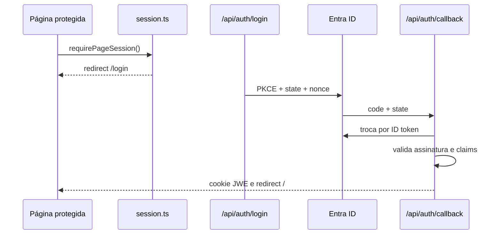

# Fluxos do sistema

Os caminhos abaixo são relativos a `operator-web`.

## Autenticação

A entrada está em `app/page.tsx`, `login/page.tsx` e rotas `api/auth`. Chamam `authConfig`, `createMicrosoftClient`, `validateMicrosoftToken` e `seal`. Falhas típicas: configuração 503, transação expirada, tenant/perfil/MFA inválidos ou Redis indisponível. Depure Network de `/api/auth/*`, terminal e testes de auth, nunca exibindo tokens.

## Fila de orçamentos

`BudgetQueue` chama `BffOperatorRepository.listBudgets()` → `GET /api/orcamentos` → `requireSession(false)` → rate limit → factory → `listBudgets()`. No SharePoint, orçamentos e itens são lidos e contados; no mock, vêm da memória. Falhas: 401, 429, 503 de configuração ou 502 do Graph. Um `200 []` é lista válida vazia.

## Abertura e itens importados

Ao clicar “Abrir”, `app/orcamentos/[budgetId]/page.tsx` passa ID e `canWrite` ao `ValidationWorkspace`. O componente carrega em paralelo `controller.load()` (`GET .../itens`), `getBudget()` (`GET /api/orcamentos`) e materiais. Itens são ordenados e o primeiro pendente é selecionado. Investigue cada uma das três requisições separadamente.

## Materiais oficiais

`GET /api/materiais?q=...` aceita consulta de até 100 caracteres. Mock e SharePoint filtram código, nome e família. A tela carrega o catálogo e `MaterialAutocomplete` filtra código/nome localmente, mostrando até seis. Compare resposta, `OfficialMaterial` e `sharepoint-mapper.ts` quando faltar dado.

## Aprovação

1. Usuário escolhe material e clica “Aprovar e próximo”.
2. `ValidationWorkspace.decide` chama `ReviewController.approveAndNext`.
3. `BffOperatorRepository.saveItemDecision` envia PATCH, JSON e ETag em `If-Match`.
4. A rota valida sessão Operador/Comprador, origem, tipo/tamanho, campos, material e versão.
5. `SharePointOperatorRepository` confirma item, fornecedor, orçamento e auditoria; o transporte verifica a permissão e tenta gravar.
6. O controller substitui o item pela resposta e avança.

Falhas: material 400, fornecedor/orçamento/ETag 409, versão 428, perfil/permissão 403, auditoria 503, Graph 502. A sugestão não é copiada.

## Rejeição

O caminho é o mesmo via `ReviewController.reject`, mas `approvedMaterialId` deve ser `null`, fornecedor não é exigido e a seleção não avança. O PATCH grava status, observação, auditoria e limpa material aprovado sem tocar na sugestão.

## Persistência e resultado incerto

O repository relê catálogo/item/orçamento, compara ETag, cria `decisionId`, registra intenção no Redis e chama `graph.patch`. Registra resultado `confirmed`, `denied` ou `unconfirmed`. Falha depois do envio não prova que nada foi gravado: recarregue/reconcilie pelo ID antes de repetir. Esse fluxo está implementado e testado com Graph simulado; a persistência em `Itens_Importados` real ainda depende de Redis, colunas de auditoria, concessões Graph e teste controlado.

## Erros, concorrência e permissões

`routeErrorResponse()` traduz `AuthError`, `DecisionError`, configuração e falha desconhecida sem expor secrets. Status importantes: 401 sessão; 403 perfil/origem/Graph; 409 conflito/regra; 413/415 corpo; 428 versão; 429 limite; 502/503 dependência.

`saving` evita ações concorrentes na mesma tela; ETag protege entre abas/usuários. Graph 412 vira 409. Há 60 leituras e 20 escritas por usuário/minuto. Todos os perfis autorizados veem toda a fila; não há segregação por orçamento.

A verificação prévia chama `GET /sites/{site-id}/lists/{list-id}/permissions` usando a base `v1.0`. Como a referência localizada para listar permissões da lista está publicada como beta, existe uma hipótese de incompatibilidade. Ela só passa a ser problema confirmado se uma chamada de leitura autorizada reproduzir a falha; até lá, não altere endpoint nem amplie permissões por suposição.

Para depurar: ação visual → controller → BFF repository → rota → factory → repository → transport → serviço externo. Veja [Guia de debug](GUIA-DE-DEBUG.md).
